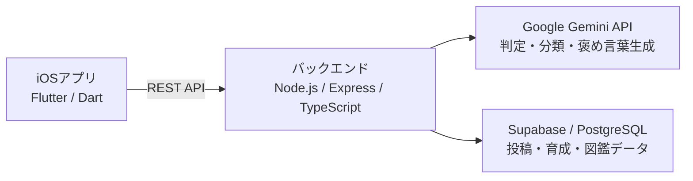

# よいのこ

> **今日の「よいこと」が、明日のこの子を育てる。**

「よいのこ」は、日常の小さな「よいこと」を記録し、その積み重ねによってキャラクターが成長・進化する、iOS向け育成アプリです。行動を記録して終わりにするのではなく、**自分の行動がキャラクターの姿に変わり、その思い出が図鑑に残る**体験を通じて、次の「よいこと」へのきっかけをつくります。

**開発状況：開発中**（以下には実装予定・検討中の機能も含まれます）

<!-- TODO: デモ動画公開後、サムネイル画像と動画URLを追加してください。 -->
<!-- 例:  -->

## 製品概要

### 背景（製品開発のきっかけ、課題等）

私たちは、日常の小さな「よいこと」が積み重なれば、周囲の人々や環境が少しずつ良くなり、社会全体にも良い変化が生まれるのではないかと考えました。

一方で、人との関わりが希薄になっていると感じたり、自分の生活に精一杯で周囲を気にかける余裕がなかったりすることがあります。私たち自身も、「毎日よいことをしよう」と思い続けることは簡単ではありません。

そこで着目したのは、**「よいこと」は毎日同じ行動を繰り返すとは限らない**という点です。誰かに感謝を伝える、落ちているごみを拾う、自分をきちんと休ませるなど、内容はその日の状況によって変わります。あらかじめ決めたタスクの達成を記録するだけでは、こうした多様な行動を一つの「成長の実感」として捉えにくいのではないか、と考えました。

私たちが目指すのは、「よいこと」を義務にすることでも、行動の善し悪しを人に押しつけることでもありません。**小さな行動が認められ、目に見える成長につながることで、自然とまた行動したくなる体験**です。そのために、AIによる内容理解と、キャラクターの分岐進化・歴代図鑑を組み合わせた「よいのこ」を考案しました。

### 製品説明（具体的な製品の説明）

ユーザーがその日に行った「よいこと」を文章で投稿すると、AIが内容を判定して7種類の属性のいずれかに分類します。認められた投稿には経験値（XP）と属性ポイントが付与され、育成中のキャラクターが成長します。また、AIが投稿内容に合わせた褒め言葉を生成し、キャラクターが一つひとつの行動を褒めてくれます。

育成の流れは、**「投稿する → 認めてもらう → 成長・進化する → 図鑑で振り返る」**の4段階です。キャラクターは初期形態から2段階進化し、最終進化に到達した日にはその子と最後まで過ごせます。翌日には新しいキャラクターが生まれ、XPと属性ポイントが0の状態から次の育成が始まります。育て終えたキャラクターは、投稿履歴とともに歴代図鑑に残ります。

主な利用者として想定しているのは、年齢を問わず、日常の「よいこと」を意識するきっかけや、楽しみながら継続する動機がほしい人です。現段階では投稿は本人だけが閲覧する設計で、写真や音声ではなく文章で手軽に記録できます。

### 特長

#### 1. 「何をしたか」で進化先が変わる、49通りの育成

AIが投稿内容を分析し、次の7属性から最も適切なものを1つ選びます。

| 属性 | 「よいこと」の例 |
| --- | --- |
| 思いやり | 困っている人を手伝う |
| 環境保全 | ごみを拾う、節電する |
| 感謝 | 家族や友人に感謝を伝える |
| 勇気 | 困っている人に自分から声をかける |
| 協力 | 周囲の人と協力して作業する |
| セルフケア | 自分の心身を気遣い、休息を取る |
| 誠実 | 間違いを認める、約束を守る |

第一進化は7種類、第二進化（最終進化）は**7×7＝49種類**の組み合わせを想定しています。第二進化の判定には、初期形態から蓄積した属性ポイントの累計を用います。属性ごとのポイントは数値でも確認できるため、どのような「よいこと」を重ねてきたかを振り返れます。

「決められたタスクを何回達成したか」だけではなく、**日々の多様な行動の傾向が、自分だけの育成結果として表れる**ことが特徴です。

#### 2. 育てたキャラクターと「よいこと」が残る歴代図鑑

最終進化したキャラクターは、歴代図鑑に保存されます。キャラクターごとの詳細画面では、世代・育成期間・累計XP・投稿件数に加えて、その子と一緒に積み重ねた「よいこと」や、AIから受け取った褒め言葉を振り返れます。

**図鑑を集める楽しさ**と、**過去の自分の行動が残る達成感**を一つにつなげることで、次のキャラクターも育てたくなる仕組みを目指しています。

**画面イメージ（開発中。表示文言・デザインは変更予定）**

| 歴代図鑑 | キャラクター詳細・「よいこと」の記録 |
| --- | --- |
|  |  |

#### 3. AIの褒め言葉と、投稿を続けられる報酬設計

AIは固定の定型文ではなく、投稿された「よいこと」の内容に応じて個別の褒め言葉を生成する予定です。小さな行動でも「認められた」と感じられることを、次の行動への動機につなげます。

| 項目 | 仕様 |
| --- | --- |
| 1投稿で獲得するXP | 10 XP |
| 1投稿で獲得する属性ポイント | 該当属性に1ポイント |
| 1日の獲得上限 | 50 XP／属性ポイント合計5ポイント |
| 上限到達後 | 投稿・記録・AIによる褒め言葉は継続可能。XPと属性ポイントは加算しない |

AIが「よいこと」に該当しないと判定した投稿も、**記録自体は保存**します。ただしXPと属性ポイントは付与しません。判定に納得できない場合は、元の文章を編集・上書きして再判定を受けられる仕組みを予定しています。

経験値を獲得できないときでも記録や褒め言葉を止めないのは、**ポイント稼ぎよりも「よいこと」を続けることを大切にしたい**からです。

### 解決出来ること

「よいことをしたい」という気持ちがあっても、具体的な行動や継続につながりにくいという課題に対して、次のような体験を提供します。

- **行動のきっかけ：** 身近な「よいこと」を見つけて記録することで、日常の小さな行動に目を向けやすくする。
- **達成感の可視化：** 投稿の積み重ねをキャラクターの成長と進化に変え、行動の手応えを得られるようにする。
- **継続の動機：** 褒め言葉、新しい進化先との出会い、歴代図鑑への収集によって、次の投稿を楽しみにできるようにする。
- **自分自身の肯定：** 他者への親切だけでなくセルフケアも「よいこと」として扱い、自分を大切にする行動も認める。

これは現時点での**製品仮説**であり、行動継続への効果が実証されたと主張するものではありません。今後は利用者の声や継続利用の状況を通じて、設計の有効性を検証したいと考えています。

### 今後の展望

**1. キャラクターの種類・リアクションの拡充**

現在想定している49種類の最終進化からさらにキャラクターを増やし、同じ属性の組み合わせでも違う姿に出会えるようにしたいと考えています。加えて、**Riveの導入を検討**し、投稿内容や褒め言葉、成長・進化の場面に応じて表情や動きが変わる演出を目指します。文字だけの褒め言葉から、キャラクターに直接認めてもらっているように感じられる体験へと発展させたいと考えています。

**2. 過去の行動に基づくAIの「よいこと」提案**

投稿履歴や7属性のポイント傾向をもとに、AIが無理なく取り組める「よいこと」を提案する機能を検討しています。例えば、環境保全の投稿が少ないユーザーに「今日は使っていない部屋の電気を消してみませんか」と提案するなど、**何をすればよいか迷ったときの最初の一歩**を支援します。提案は命令や義務ではなく、ユーザーが自由に選べるきっかけとして設計します。

**3. SNS機能の検討**

現状は本人だけが記録を閲覧できる設計ですが、将来的には他のユーザーと「よいこと」や育成の楽しさを共有するSNS機能も検討しています。個人の記録を尊重しながら、小さな行動の輪を広げる方法を模索します。

### 注力したこと（こだわり等）

**技術面：AI判定と分岐進化を結びつける設計**

自由に入力された文章をAIが読み取り、「よいこと」かどうかの判定と属性分類を行い、その結果をゲーム内のXP・属性ポイント・進化判定につなげる構成に注力しています。単に生成AIから文章を返すのではなく、**現実の行動を一貫した育成ルールに変換する**部分を重視しています。AIによる誤判定も想定し、投稿の書き直しによる再判定を設計に含めています。

**ユーザー体験：記録を達成感へ、達成感を次の行動へ**

最大のこだわりは、投稿の回数そのものよりも、行った「よいこと」がキャラクターの成長として可視化されることです。さらに歴代図鑑に行動の履歴を残すことで、育成の楽しさが一過性で終わらないようにしています。1日の獲得上限を超えても投稿を可能にしたのも、「よいこと」をする動機を数値的報酬だけに限定しないためです。

## 開発技術

### 活用した技術

> 以下は現在の開発構成・採用方針です。各要素は開発中であり、最終的な実装状況に合わせて提出前に更新します。**RiveとAIの行動提案機能は現時点では検討段階**です。

#### API・データ

- **Google Gemini API**：投稿内容の「よいこと」判定、7属性への分類、内容に応じた褒め言葉の生成
- **Supabase（PostgreSQL）**：ユーザー情報、キャラクターの育成状態、属性ポイント、投稿履歴、歴代図鑑データの管理
- **REST API / HTTP**：Flutterアプリとバックエンドの連携

#### フレームワーク・ライブラリ・モジュール

| 分類 | 技術 | 主な用途 |
| --- | --- | --- |
| フロントエンド | Flutter / Dart | iOSアプリの画面・操作の実装 |
| UI | Flutter Widgets / Material Design 3 | 画面コンポーネントの構築 |
| 状態管理 | Riverpod（flutter_riverpod） | 育成状態・画面状態の管理 |
| 画面遷移 | go_router | 画面間のルーティング |
| アニメーション | flutter_animate / AnimationController | 画面やキャラクターの演出 |
| 通信 | supabase_flutter / HTTP API | データ操作とバックエンド連携 |
| バックエンド | Node.js / Express / TypeScript | API・ゲームロジックの実装 |
| データベース | Supabase / PostgreSQL | 育成・投稿データの永続化 |
| 生成AI | Google Gemini API | 投稿判定・属性分類・褒め言葉生成 |

キャラクター表示には透過PNG画像とFlutterの描画・アニメーション機能を想定しています。Riveは、より豊かな表情や動作を実現するための**導入検討中の技術**です。

#### デバイス

- **対応予定：iOS（iPhone）**
- **開発環境：Mac、Visual Studio Code、Xcode**
- **その他の開発ツール：Android Studio（SDK等の開発環境用。Android版は今回の開発対象外）**

#### システム構成（開発中）

また、ゲーム開始時にはメールアドレス等の登録を必須とせず、後から設定画面で**重複しないIDとパスワードによる引き継ぎ設定**を行える方式を予定しています。端末内保存とサーバー保存の具体的な分担は検討中です。

### 独自技術

#### ハッカソンで開発した独自機能・技術

**1. 自然言語の投稿をゲーム内の属性へ変換する仕組み**

ユーザーが自由文で投稿した「よいこと」をAIで判定・分類し、その結果を属性ポイントとして蓄積する仕組みを設計しています。分類結果をそのまま表示して終わりにせず、育成状態へ反映させる点が中心です。

**2. 属性の累積に基づくキャラクターの分岐進化**

第一進化・第二進化の段階と7属性の累計ポイントを組み合わせ、ユーザーの行動傾向がキャラクターの最終的な姿に反映される進化ロジックを設計しています。世代交代時には新しい育成状態を0から開始しつつ、完了したキャラクターと対応する投稿履歴を図鑑に残す構成です。

**3. 投稿内容に応じたフィードバックと再判定**

投稿内容に合わせた褒め言葉の生成に加え、「よいこと」と認定されなかった投稿も記録し、文章を編集して再判定できる体験を設計しています。AIによる判定を絶対的な評価として扱わず、ユーザーが自分の行動を説明し直せる余地を残します。

**特に力を入れた実装箇所（提出前にリンクを追加）**

- AIによる判定・属性分類処理：`TODO: ファイルURL / commit ID`
- XP・属性ポイント・進化判定ロジック：`TODO: ファイルURL / commit ID`
- 歴代図鑑と投稿履歴の管理：`TODO: ファイルURL / commit ID`
- AIによる褒め言葉生成：`TODO: ファイルURL / commit ID`

---

「よいのこ」が目指しているのは、「よいこと」を評価されるための義務にするのではなく、**自分が少しだけ周囲や自分自身を大切にしたくなるきっかけ**を増やすことです。今日の小さな行動がこの子を育て、その成長が明日の新しい行動につながる。そんな循環をつくりたいと考えています。
