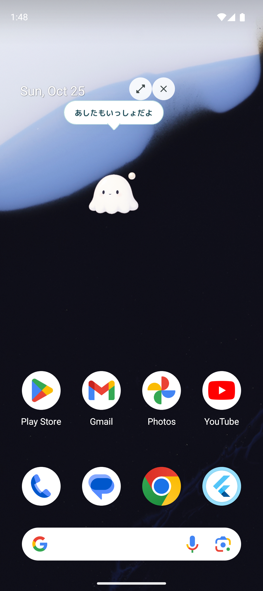

# Android版と、よいのこのおでかけ

Android 8.0（API 26）以降向けです。Flutterの既存の育成画面・57形態の画像・種族ごとの動き・キャラごとのセリフを共通で使います。AndroidのアプリIDは `jp.yoinoko.app` です。



## 使い方

1. アプリを起動して、よいのこを迎えます。
2. 「せってい」→「よいのことおでかけ」→「表示を許可する」を押します。
3. Androidの設定で、よいのこの「他のアプリの上に表示」を許可してアプリに戻ります。
4. 「おでかけする」をONにします。通知の許可が表示されたら、許可すると通知からも終了できます。
5. ホーム画面に戻ると、現在育てているよいのこが現れます。

キャラは休憩を挟んで画面内を歩き、タップするとキャラ固有の別のセリフを文字で表示します。約40秒おきにもひとこと話します。ドラッグで好きな場所へ移動でき、右上の拡大ボタンでアプリへ戻れます。×ボタン、常駐通知の「おでかけを終了」、設定のスイッチのいずれでも終了できます。

アプリ内では外側のキャラを隠し、画面のロック中・画面OFF中も表示と移動を休止します。解除後は再表示します。進化・世代交代・HPなどは、アプリで状態が更新されるとおでかけ中のキャラにも反映します。退会すると表示を終了し、おでかけ用に保存したキャラのコピーも削除します。

## ビルドと起動

`frontend/` で実行します。

```sh
flutter pub get
flutter run -d <Android端末ID> --dart-define=APP_MODE=demo
flutter build apk --debug --dart-define=APP_MODE=demo
```

確認用APKは `build/app/outputs/flutter-apk/app-debug.apk` に生成されます。

一般的なARM64のAndroid端末に入れる試用版は、次のコマンドで生成できます。

```sh
flutter build apk --release --target-platform android-arm64 --dart-define=APP_MODE=demo
```

生成先は `build/app/outputs/flutter-apk/app-release.apk` です。現在は開発用の鍵で署名します。

実APIへ接続する場合は、公開HTTPSの接続先を指定してください。

```sh
flutter run -d <Android端末ID> --dart-define=APP_MODE=api --dart-define=API_BASE_URL=https://YOUR_HOST/api
```

このデモはAndroid端末内の別データです。iPhone内のデモの育成記録は自動では引き継がれません。APIモードでも、既存の引き継ぎ機能は未実装です。

## 実装と制約

- `lib/core/android_pet.dart` がアプリ側とAndroid側をつなぎ、キャラのデータだけを送ります。ログイントークンやAPI接続情報は渡しません。
- `PetOverlayService.kt` が `TYPE_APPLICATION_OVERLAY` の小さい透過ウィンドウと、ユーザーが開始・終了できるフォアグラウンドサービスを管理します。
- `petOverlayMain` から起動する別のFlutterエンジンで、既存の `CharacterView`・`RoomWander`・セリフ一覧を再利用します。アカウントや育成の処理を二重に起動しません。
- ホーム画面だけでなく、他のアプリの上にも表示されます。画面全体の透明なビューで操作を奪わず、キャラのいる小さな領域だけでタッチを受け取ります。
- ロック画面への表示、音声会話、自動起動は含みません。端末再起動・強制終了・OSによる停止後は、アプリから再びONにします。
- 省電力設定やメーカー独自の常駐制限で停止する場合があります。長時間の電池消費とメーカーごとの実機検証は別途必要です。
- Android 14以降では `specialUse` のサービス種別を宣言しています。Google Playへの公開には用途の申告と審査が必要です。
- 現在のrelease設定は開発用署名です。ストア公開用の鍵・署名設定・配布手続きは別途必要です。

## 確認

```sh
flutter analyze
flutter test
flutter build apk --debug --dart-define=APP_MODE=demo
```

権限拒否時の表示、開始／終了、進化と退会の同期順、iOSへの影響がないこと、おでかけ用の小さい画面でのキャラ表示・セリフ切り替え・ドラッグ・終了をテストします。

2026-10-25時点で、静的チェック・48件のFlutterテスト・debug APKとARM64 release APKのビルド成功を確認しました。Pixel 9 / Android 16エミュレーターで初回起動、育成ホーム、ホーム画面と他アプリの上での透過表示、文字のおしゃべりと移動を確認しています。物理端末の検証は未実施です。
